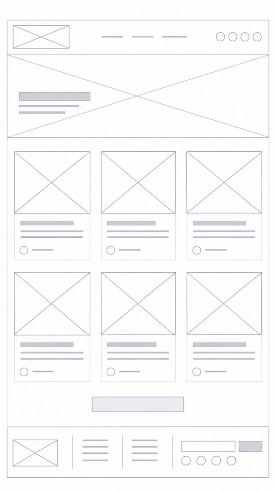

# Blog (listing)

| #   | Section      | Content                                                                                                                         |
| --- | ------------ | ------------------------------------------------------------------------------------------------------------------------------- |
| 1   | Header       | Same as Home; **Blog** marked active in the menu                                                                                |
| 2   | Intro banner | Full-width image with a simpler title + short text overlaid at bottom left                                                      |
| 3   | Post grid    | **3 columns**, grouped by category. Each card: featured photo, title, date, excerpt, basic interaction row (avatar/icon + meta) |
| 4   | Load more    | Single centered button; avoids showing too many posts at once                                                                   |
| 5   | Footer       | Same as Home                                                                                                                    |

## Intent

- Identical card format everywhere so cards don't compete visually.
- Warm accent colors highlight categories and interactive elements.
- Categories let the archive grow without changing the structure — dynamic content,
  new posts don't require redesign.
