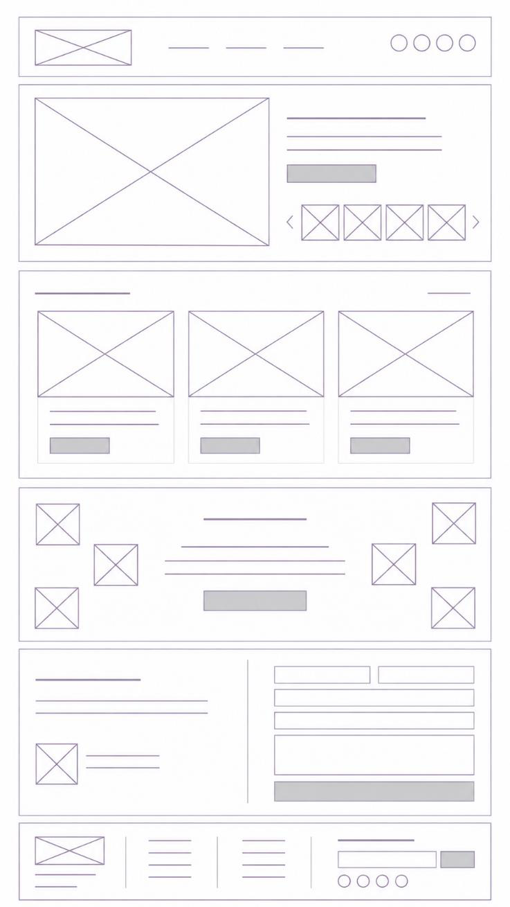

# Home

Vertical, desktop-first layout. Shows the outlet's content first, then its identity.

| # | Section | Content |
|---|---|---|
| 1 | Header | Logo · menu · social icons |
| 2 | Hero | Large featured photo (left) · title/intro text + CTA button (right) · small 4-thumbnail gallery carousel with arrows |
| 3 | Recent posts | Section title + "see all" link · **3 cards** in a row (image, title, date, excerpt, button) |
| 4 | About Lara Cuenta | Centered title, text and button, framed by scattered support photos on both sides |
| 5 | Contact | Left: title, text, small image + caption. Right: form (2 short fields side by side, 2 full-width fields, message textarea, submit button) |
| 6 | Footer | See shared components |

## Intent

- Photos are the outlet's main element; the hero highlights them.
- Three cards show variety without visual overload.
- About comes after posts: content first, purpose for those who want to dig deeper.
- Contact form lets readers ask questions, share their stories or pitch topics.
- Cards link to the full post; buttons are for concrete actions.
