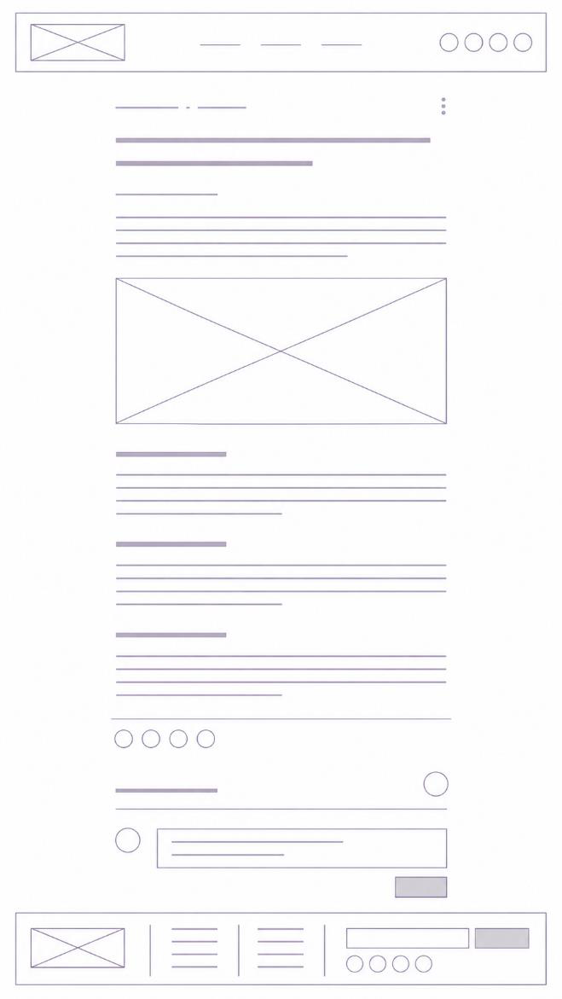

# Blog post

Single centered column with wide side margins, focused on reading.

| #   | Section        | Content                                                                                                                     |
| --- | -------------- | --------------------------------------------------------------------------------------------------------------------------- |
| 1   | Header         | Same as Home                                                                                                                |
| 2   | Meta row       | Publish date · estimated reading time · overflow menu (⋮) on the right                                                      |
| 3   | Title          | Main title (up to 2 lines)                                                                                                  |
| 4   | Category       | Category label                                                                                                              |
| 5   | Lead           | Short intro or a quote from the story                                                                                       |
| 6   | Featured image | Wide image after the intro                                                                                                  |
| 7   | Body           | Text blocks with subheadings; shape depends on the journalistic genre. May include extra images, subheadings or testimonies |
| 8   | Share          | Social share icons, after the article                                                                                       |
| 9   | Comments       | Title + count/avatar · comment box with avatar · submit button                                                              |
| 10  | Footer         | Same as Home                                                                                                                |

## Intent

- Share and comments go last so they don't interrupt reading.
- Cream background, restrained color so images lead; final color choices are made once
  the real site is reviewed.
- One reusable template for every post: only title, category, date, images and body vary.

## Builder implications

Front matter each article needs: `title`, `date`, `category`, `excerpt` (lead),
`cover` (featured image). Reading time is computed at build time. Share links are static;
comments need a backend (see `docs/wix-runbook.md`).
