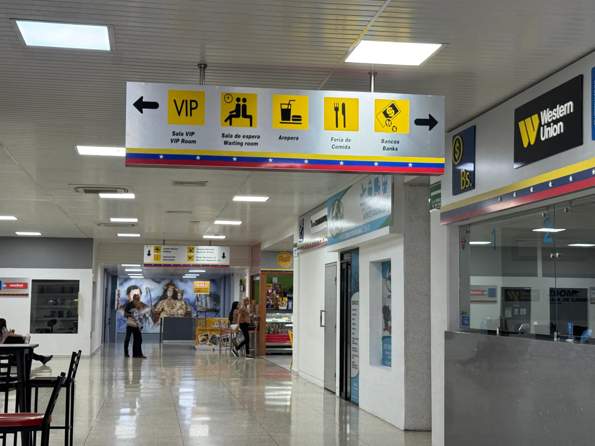
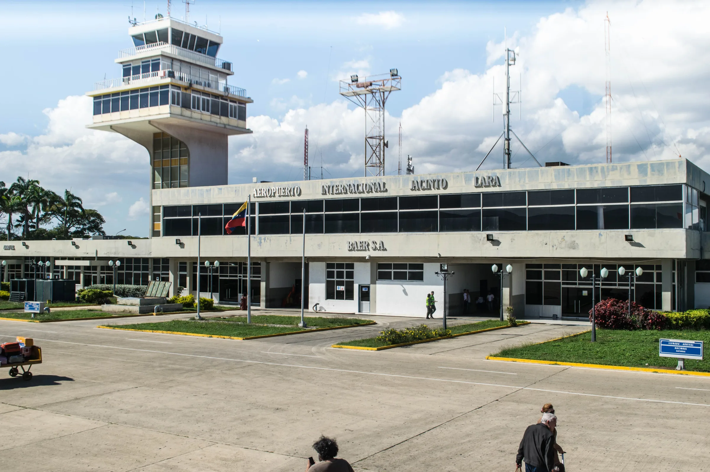
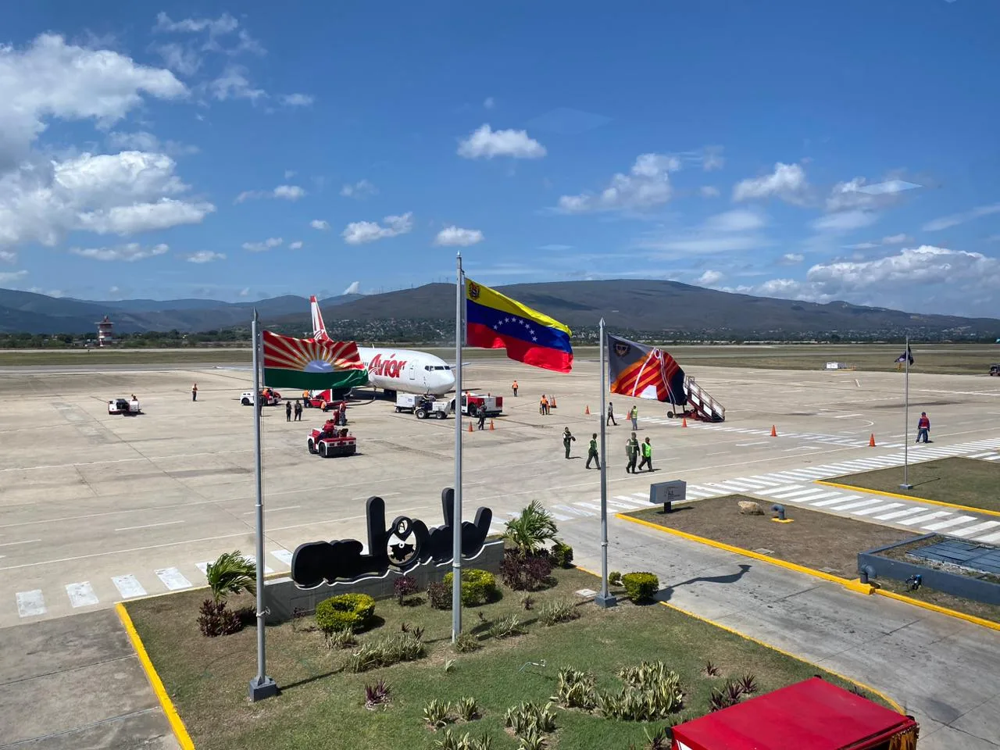
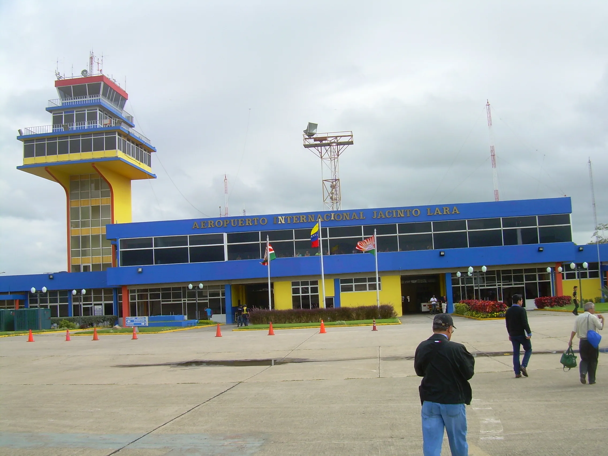
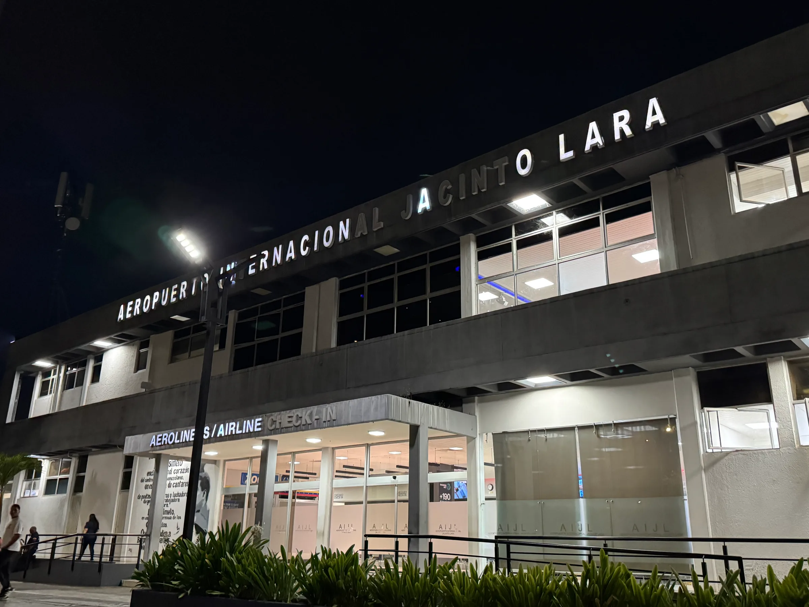
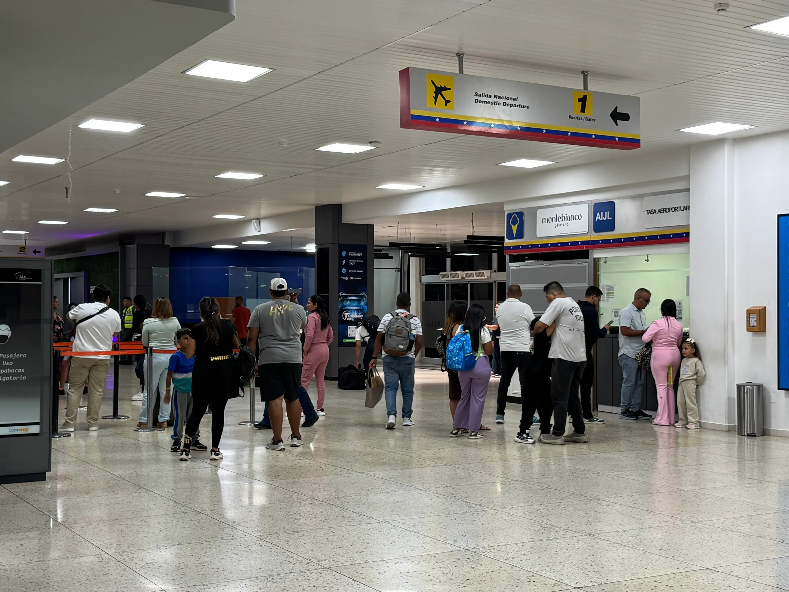
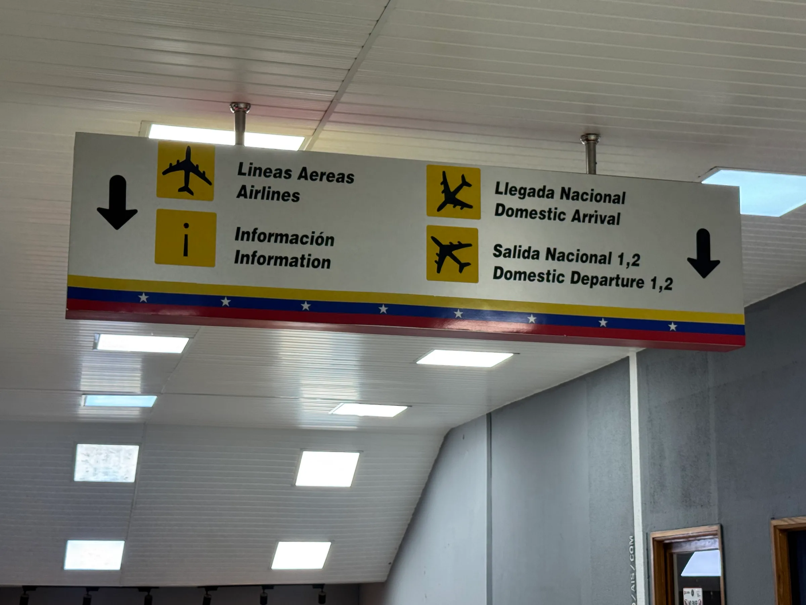
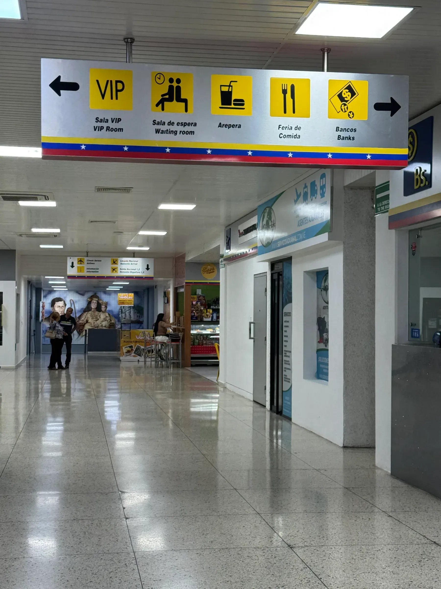
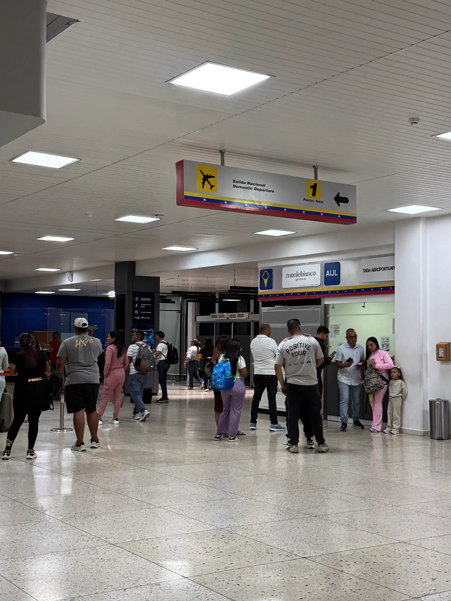

Entre sus paredes viven miles de historias: el abuelo que lleva de la mano a su nieto y lo envía a reencontrarse con sus padres, la familia que planificó unas vacaciones en territorio nacional y comparten sonrisas en este entorno a veces tan triste o quienes esperan con ansias a sus familiares que vienen de vuelta desde otro país o estado.

<PullQuote>
  Los abrazos que no encuentran fin y las miradas que permanecen atentas a la puerta de llegada.
</PullQuote>

El Aeropuerto Internacional Jacinto Lara espera en el oeste de Barquisimeto con un ambiente de nostalgia y reflexión. Desde el momento en que se divisa el espacio, se observan sus luces cansadas, algunas de las cuales ya no permiten distinguir el nombre completo del lugar. Aun así, entre sus pasillos, algunos restaurantes y negocios permanecen activos a la espera de los viajeros.

<Figure credit="Foto: Mariángel León Ortiz.">

</Figure>

## Antes de las despedidas

Pero, mucho antes de convertirse en un lugar de despedidas y reencuentros, el aeropuerto fue testigo de acontecimientos que marcaron el crecimiento de la ciudad. Sus antecedentes se remontan a los primeros años de la aviación larense, cuando los vuelos comerciales apenas comenzaban a desarrollarse y Barquisimeto contaba con un pequeño terminal y una torre de control en los terrenos del antiguo campo de aviación.

Hacia 1950 comenzaron los trabajos de construcción y ampliación de las pistas. Según los registros históricos recopilados por el cronista Carlos Guerra Brandt, estas instalaciones recibieron en 1952 a las delegaciones nacionales e internacionales que llegaron para celebrar los 400 años de la fundación de Barquisimeto.

<Archive credit="Archivo, autor sin identificar.">

</Archive>

Años después, bajo la dirección del Ministerio de Obras Públicas, se aceleraron los trabajos del nuevo terminal aéreo inaugurado el 4 de junio de 1963 por el entonces presidente, Rómulo Betancourt, y el gobernador del estado Lara, Argimiro Bracamonte. En 1969 el aeropuerto alcanzó la categoría internacional con la apertura de las conexiones de Viasa hacia Miami y Kingston.

<Timeline
  title="Del campo de aviación al vuelo internacional"
  description="Las fechas que marcaron al aeropuerto."
>
  <Moment date="1950">Comienzan los trabajos de construcción de las pistas actuales.</Moment>
  <Moment date="1952">
    Recibe a las delegaciones que llegan a celebrar los 400 años de Barquisimeto.
  </Moment>
  <Moment date="1963" datetime="1963-06-04">
    Rómulo Betancourt y Argimiro Bracamonte inauguran el nuevo terminal, el 4 de junio.
  </Moment>
  <Moment date="1981">Avensa abre la ruta a Maiquetía, conocida como El Madrugador.</Moment>
</Timeline>

## Las historias del terminal

Con el transcurso de los años, sus espacios también fueron protagonistas de historias cotidianas. El periodista Salvador Macías dedicó una columna del diario _El Impulso_, llamada _Aeroreporta_, a registrar las llegadas y salidas de pasajeros, además de las conversaciones que surgían en el terminal. Una forma de contar quiénes se marchaban y quiénes volvían a encontrarse con Barquisimeto.

Aún vive en la memoria de algunos viajeros el vuelo de Avensa conocido como _El Madrugador_, que desde 1981 conectaba a Barquisimeto con Maiquetía. Para muchos, aquellas rutas significaban oportunidades de trabajo, visitas familiares y la posibilidad de conocer otros lugares.

<Archive credit="Archivo, autor sin identificar.">

</Archive>

## Despedidas y reencuentros

Hoy, las razones para recorrer sus pasillos han cambiado junto con la realidad de Venezuela. Las despedidas se han hecho más difíciles para quienes no saben cuándo podrán volver a abrazarse y las llegadas representan la emoción de recuperar, aunque sea por unos días, la cercanía de quienes se encuentran lejos.

<ThenNow title="La misma fachada" description="La terminal pintada de amarillo y azul, y hoy, de noche.">

<Archive year="2006" credit="Archivo, autor sin identificar.">

</Archive>

<Now year="2026" credit="Foto: Mariángel León Ortiz.">

</Now>

</ThenNow>

El aeropuerto se vuelve él mismo con las maletas que recorren sus pasillos, las conversaciones que intentan alargar una despedida, los abrazos que no encuentran fin y las miradas que permanecen atentas a la puerta de llegada. Entre la incertidumbre y la alegría, cada viajero lleva consigo una historia que va mucho más allá del espacio físico que alberga.

<Carousel
  title="Pasillos"
  description="Fotografías de Mariángel León Ortiz en el terminal."
  label="Galería de fotos de los pasillos del aeropuerto"
>

</Carousel>

A pesar de los años y de las transformaciones que ha vivido, el Aeropuerto Internacional Jacinto Lara sigue siendo un espacio donde conviven historias distintas, pero sentimientos reconocibles para muchos venezolanos: la esperanza de quien parte, la nostalgia de quien se queda y la alegría de quienes finalmente vuelven a encontrarse.

<Sources>

- [Luis Alberto Perozo Padua, El Impulso: El primer vuelo sobre Barquisimeto (2024)](https://www.elimpulso.com/2024/06/08/el-primer-vuelo-sobre-barquisimeto-8jun/)
- [El Impulso: Seis décadas alzando el vuelo (2026)](https://www.elimpulso.com/2026/06/04/fotos-seis-decadas-alzando-el-vuelo-la-historia-transformacion-y-vigencia-del-aeropuerto-internacional-jacinto-lara-4jun/)
- [Fundación Arquitectura y Ciudad: Aeropuerto Jacinto Lara (2014)](https://fundaayc.com/2014/09/17/1961%E2%80%A2/)
- [Historias del turismo en Venezuela (2016)](https://iutamaracay.com.ve/iuta_webpage/archivos/Historias-del-turismo-en-Venezuela-PDF.pdf)

</Sources>
