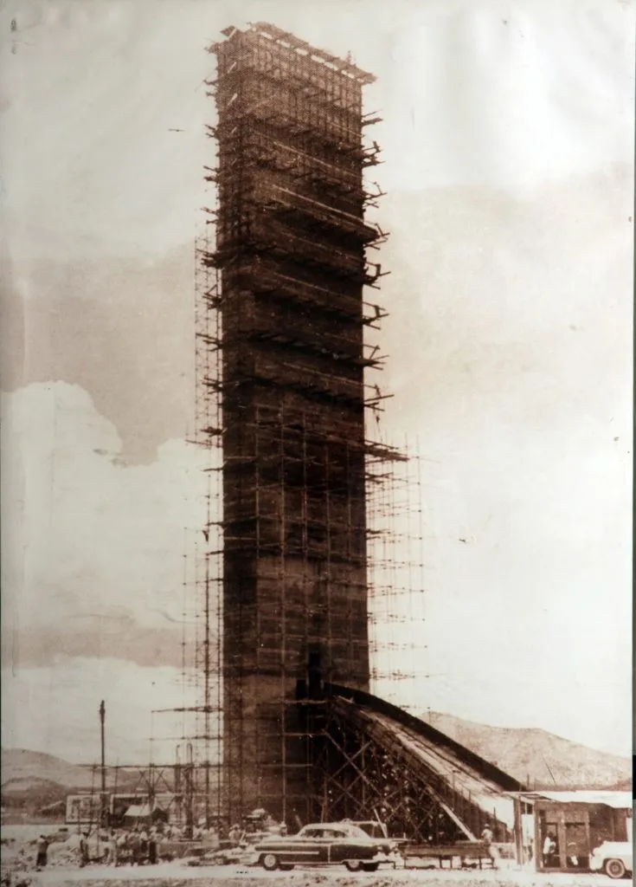
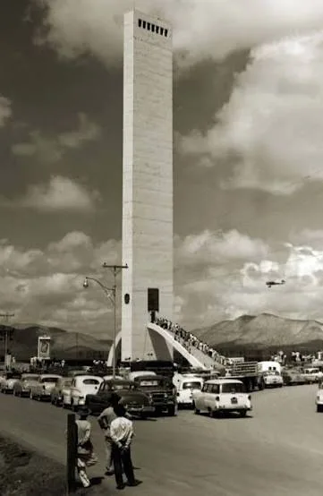
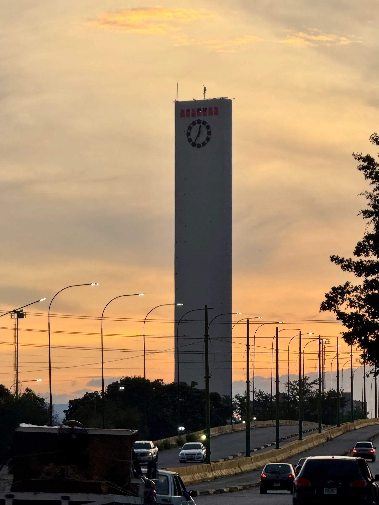
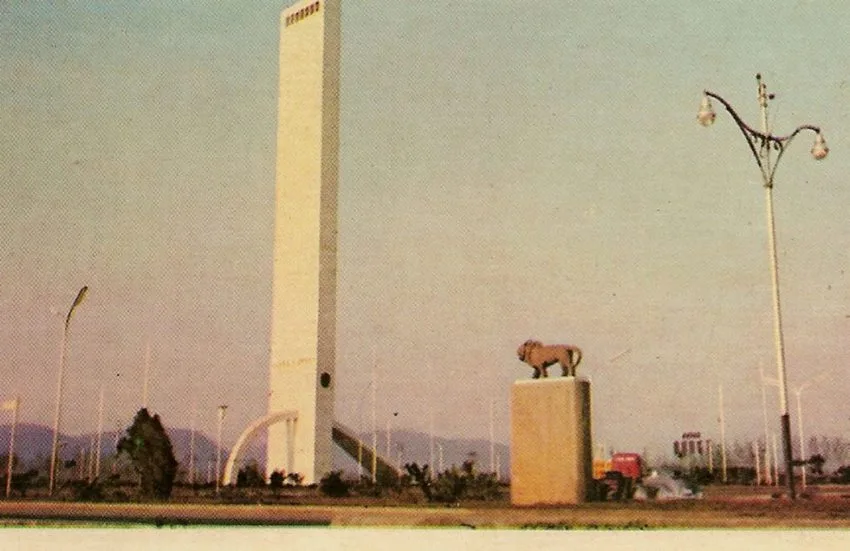
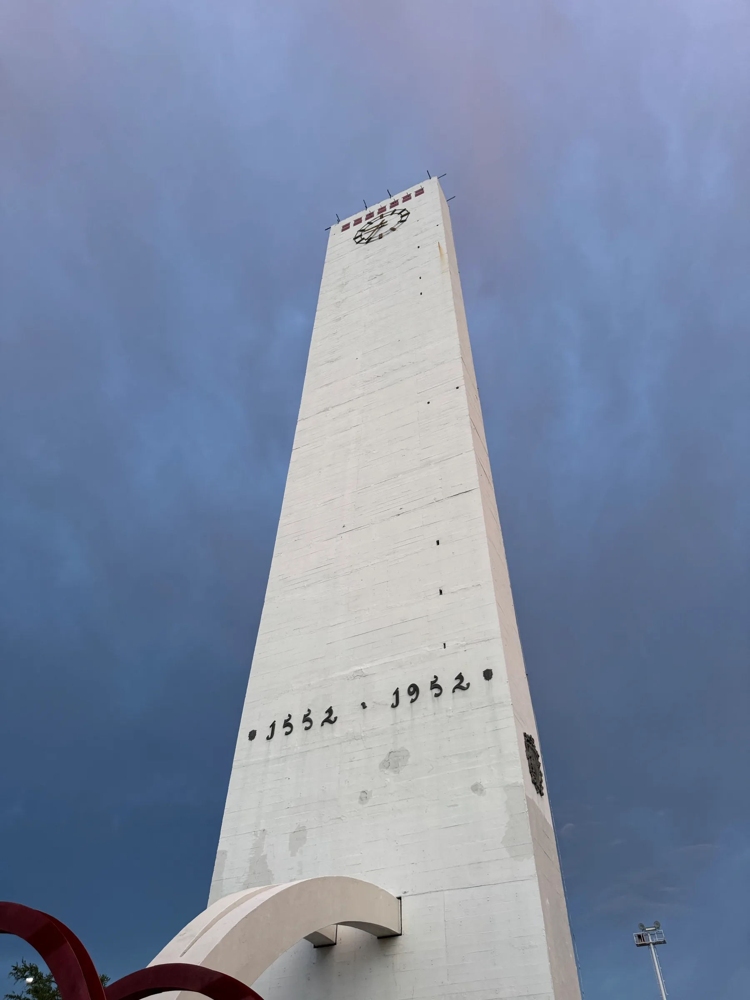
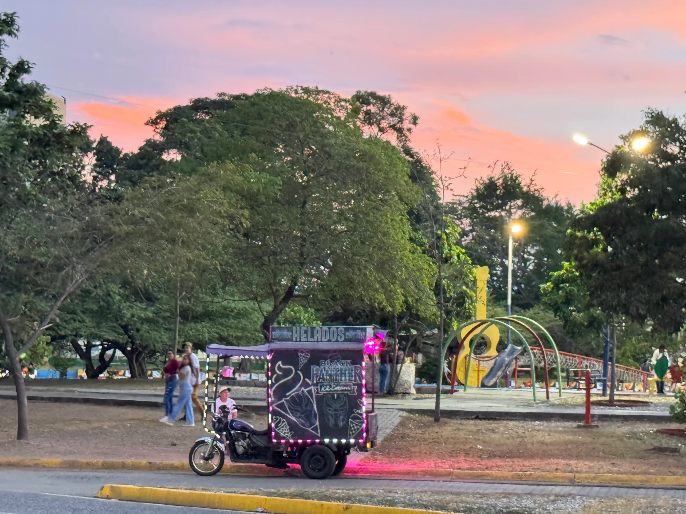
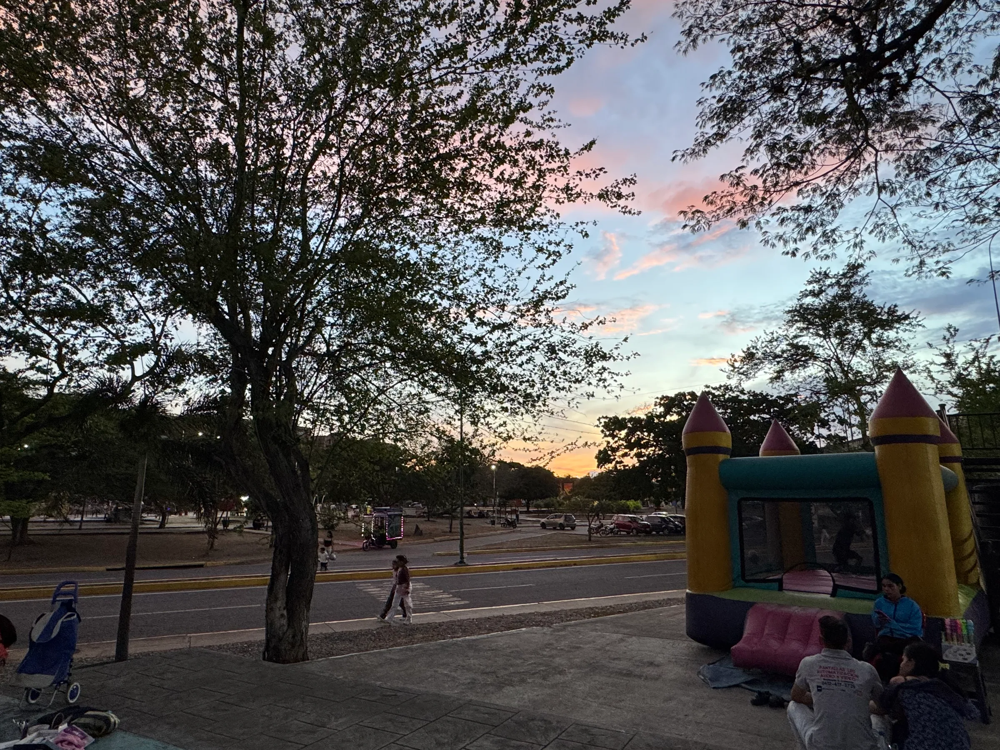
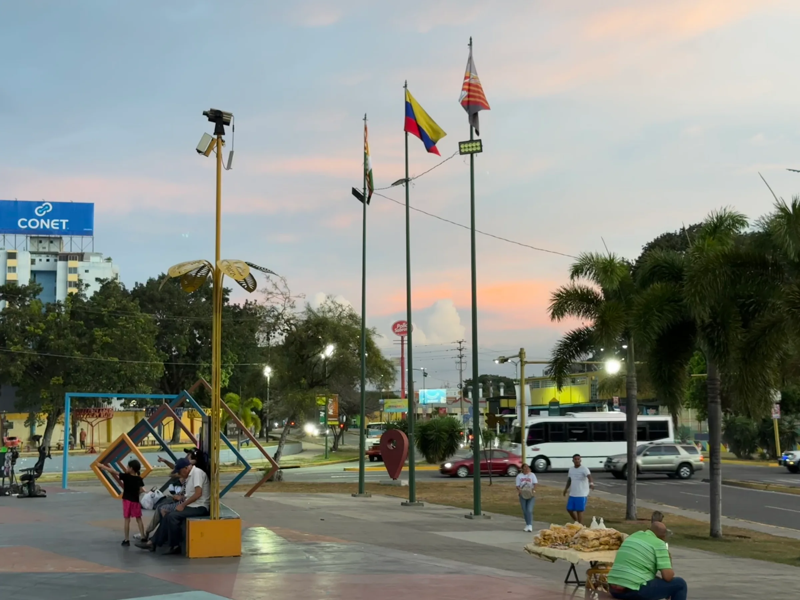
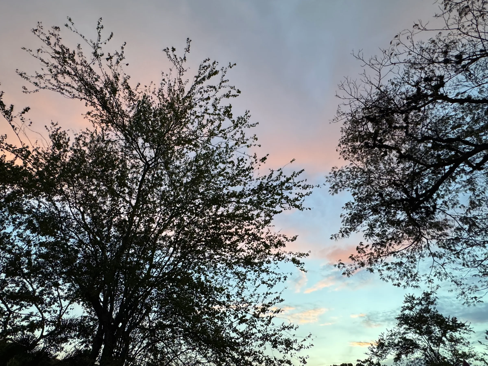

Visitar el Obelisco y sus zonas aledañas es sentirse rodeado de la energía de familias, parejas, niños y todos los barquisimetanos que desean encontrar un momento de tranquilidad y recreación para sobrellevar la velocidad que exige la vida citadina.

A pesar de los 74 años que han pasado desde su construcción, el Obelisco se conserva tras algunas labores de mantenimiento y reformas que han transformado sus espacios y sus formas de recreación, pero que, igualmente, lo preservan como un monumento histórico relevante para los barquisimetanos.

## Una obra de 45 días

Su historia inició en el año 1952 cuando, con motivo de la celebración de los 400 años de la fundación de Barquisimeto, el Ministerio de Obras Públicas impulsó su construcción. El monumento fue diseñado por el arquitecto mexicano-venezolano Gustavo Gutiérrez-Otero y Rodríguez y construido por la empresa Técnica Constructora, C. A., bajo la dirección del ingeniero Alfredo Rodríguez Delfino en apenas 45 días.

<Archive year="1952" credit="Archivo, vía IAM Venezuela.">

</Archive>

Su inauguración, el 14 de septiembre, estuvo a cargo de la Junta de Gobierno presidida por Germán Suárez Flamerich, junto a Marcos Pérez Jiménez y Luis Felipe Llovera Páez.

<Facts>
  <Fact label="Altura">75 metros (el decreto de 1952 indica 70)</Fact>
  <Fact label="Inauguración">14 de septiembre de 1952</Fact>
  <Fact label="Motivo">Los 400 años de la fundación de Barquisimeto</Fact>
  <Fact label="Diseño">Gustavo Gutiérrez-Otero y Rodríguez</Fact>
  <Fact label="Construcción">Técnica Constructora, C. A.</Fact>
  <Fact label="Tiempo de obra">45 días, según la Fundación Arquitectura y Ciudad</Fact>
  <Fact label="Dirección de obra">Ingeniero Alfredo Rodríguez Delfino</Fact>
</Facts>

En aquel entonces, el Obelisco se encontraba prácticamente a las afueras de Barquisimeto, pues la ciudad apenas se extendía hacia la calle 50 y muchas de sus vías todavía eran de tierra. Con el crecimiento urbano, aquel monumento distante se convirtió en un espacio cotidiano para generaciones de larenses.

<ThenNow title="De las afueras a la avenida" description="El Obelisco en 1956 y hoy." ratio="3 / 4">

<Archive year="1956" credit="Foto: José Francisco Chávez, vía IAM Venezuela.">

</Archive>

<Now year="2026" credit="Foto: Mariángel León Ortiz.">

</Now>

</ThenNow>

## Memorias desde el mirador

Entre las memorias que resguarda se encuentran las visitas a su mirador, desde donde era posible contemplar la ciudad. Según recuerda el cronista Reinaldo Gómez, los adultos pagaban un bolívar y los menores de 15 años, un real, para disfrutar de aquella vista. También relata que, antes de la construcción de la redoma actual, los alrededores del monumento tenían una disposición triangular que servía de escenario para que los jóvenes patinaran durante las madrugadas de las tradicionales misas de aguinaldo.

<ThenNow>

<Archive year="Años 80" credit="Foto: Alberto Perozo Padua, vía IAM Venezuela.">

</Archive>

<Now year="2026" credit="Foto: Mariángel León Ortiz.">

</Now>

</ThenNow>

Su relevancia cultural perdura, pues mantiene el título de ser el mayor obelisco de Venezuela y uno de los espacios más emblemáticos de su región. Pero, más allá de los tecnicismos, lo más alto y relevante es el punto de encuentro que representa y su capacidad de conectar a los barquisimetanos con sus raíces.

<PullQuote>Lo más alto y relevante es el punto de encuentro que representa.</PullQuote>

## Lo que se vive alrededor

En los alrededores viven los recuerdos más especiales de muchos larenses: su primera vuelta en bicicleta, las tardes con amigos o los primeros amores que surgieron allí mismo. Historias que se suman a las de quienes alguna vez contemplaron la ciudad desde su mirador o encontraron en sus espacios un lugar para compartir las tradiciones de la época. Toda esta energía persiste y se comparte con quienes, aún hoy, siguen creando recuerdos mientras pasean por sus alrededores.

Estar en la zona se resume en el viento constante, la música reconocible del carro de helados, la presencia de la vegetación, las conversaciones amenas entre amigos o familia, personas trotando, las risas de los niños en los juegos del parque cercano y las parejas que comparten gestos afectuosos.

<Carousel
  title="Una tarde en el Obelisco"
  description="Fotografías de Mariángel León Ortiz en la redoma y el parque."
  label="Galería de fotos de los alrededores del Obelisco"
>

</Carousel>

Todos conviven con propósitos distintos, pero con algo que los une: un mismo símbolo que presencia sus memorias y que, aun con el paso del tiempo y los cambios en su utilidad, sigue invitando a mirar hacia arriba para buscar eso que nos conecta con nuestras historias y nos hace sentir presentes.

<Sources>

- [Reinaldo Gómez, El Informador (2022)](https://elinformadorve.com/21/08/2022/lara/el-obelisco-de-barquisimeto-arriba-a-60-anos-de-su-inauguracion/)
- [Fundación Arquitectura y Ciudad (2017)](https://fundaayc.com/2017/03/15/1952-obelisco-de-barquisimeto/)
- [IAM Venezuela (2017)](https://iamvenezuela.org/2017/03/el-obelisco-de-barquisimeto/)
- [Wikipedia: Obelisco de Barquisimeto](https://es.wikipedia.org/wiki/Obelisco_de_Barquisimeto)

</Sources>
