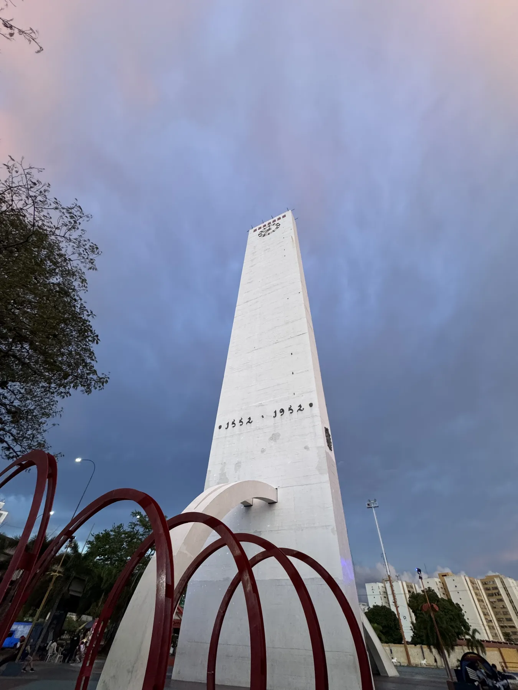
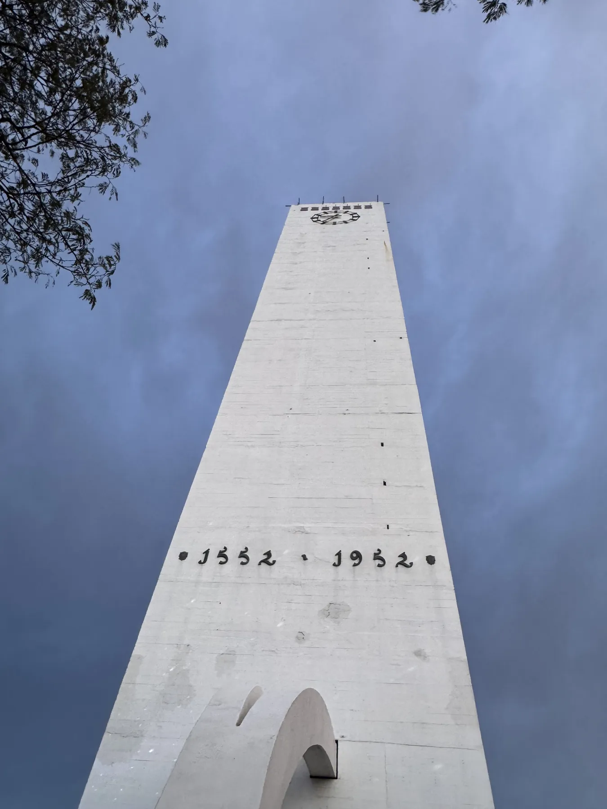
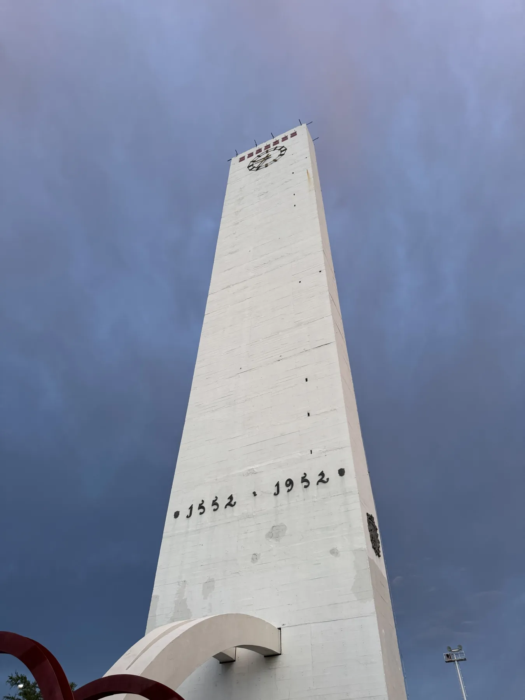
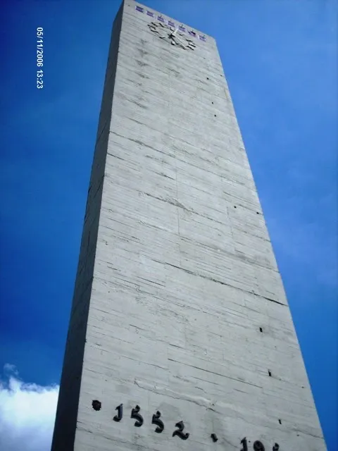
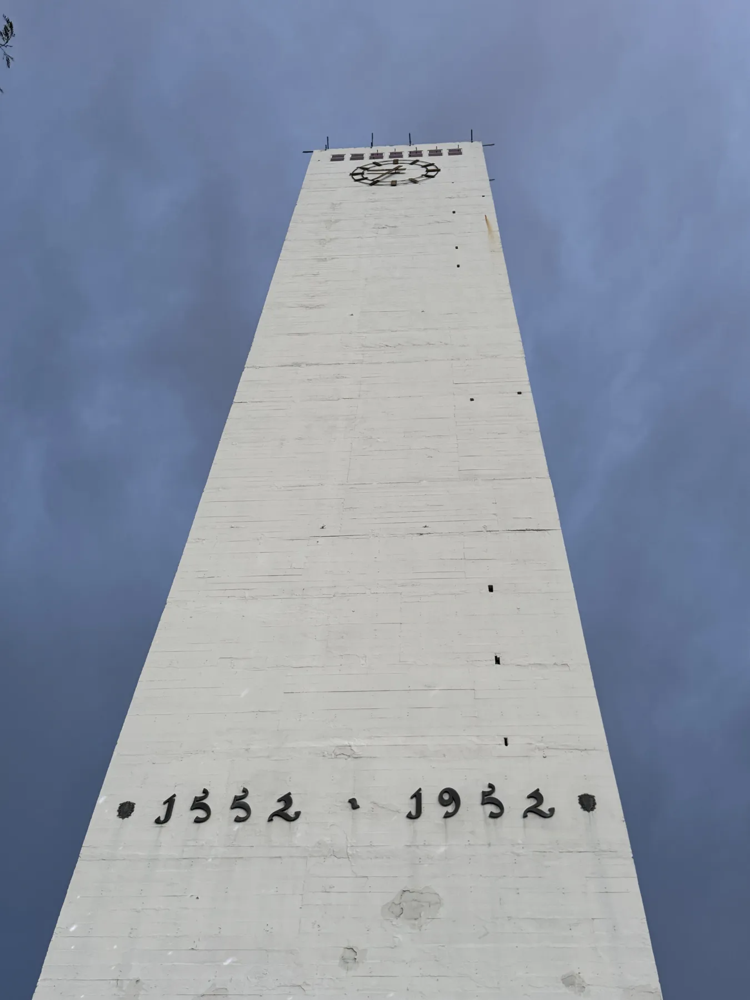
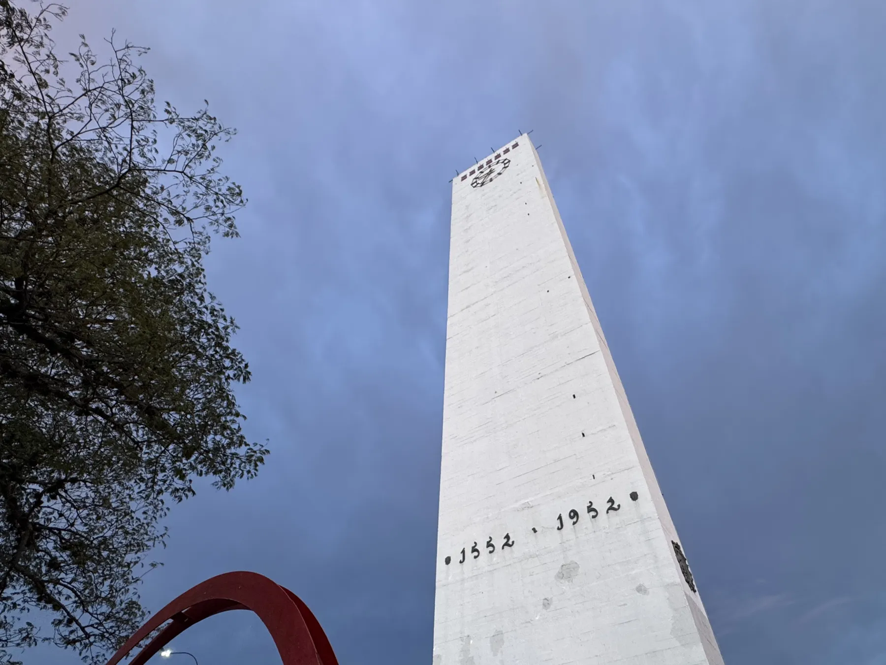

Hay ciudades que se reconocen por una montaña o por un río. Barquisimeto se reconoce por una columna blanca que no sirve para nada, y eso es exactamente lo que la hace necesaria. Nadie entra al Obelisco, nadie sube. Se mira, se señala, se usa como referencia para explicar dónde queda todo lo demás. «Pasando el Obelisco», «antes de llegar al Obelisco», «frente al Obelisco». Es el punto desde el que la ciudad mide sus distancias.

Está en el extremo oeste, en una redoma que ahora rodean seis canales de tráfico, y tiene grabada la razón de su existencia en la base: **1552 · 1952**. Cuatrocientos años entre una fecha y otra. La primera es la fundación de la ciudad por Juan de Villegas; la segunda, el año en que la ciudad decidió que merecía un monumento.

## Una ciudad que cumplía cuatro siglos

En 1952 Barquisimeto era una ciudad en obras. Se ensanchaban avenidas, se levantaban edificios de más de dos pisos, llegaba gente del campo y de otros estados. El cuatricentenario fue la excusa perfecta para hacer visible esa ambición: una comisión de festejos, desfiles, una exposición industrial y, como pieza central, un obelisco que se viera desde cualquier parte.

El diseño se encargó a un ingeniero local y se levantó en pocos meses sobre una colina que entonces estaba fuera de la ciudad. Setenta y cinco metros de concreto armado, con un mirador en la punta que estuvo abierto al público durante años. Las fotos de la inauguración muestran una llanura, un camino de tierra y una multitud de sombreros.

<Timeline
  title="Cuatro fechas para una columna"
  description="Lo que pasó alrededor del Obelisco, antes y después de que existiera."
>
  <Moment date="1552">
    Juan de Villegas funda Nueva Segovia de Barquisimeto. La ciudad cambia de sitio tres veces antes
    de quedarse donde está.
  </Moment>
  <Moment date="1952">
    Cuatricentenario. Se inaugura el Obelisco en una colina al oeste, todavía rodeado de monte y
    camino de tierra.
  </Moment>
  <Moment date="1970–1990" datetime="1970">
    La avenida crece hasta rodearlo. Llegan la redoma, los semáforos, los primeros edificios y la
    escultura roja a sus pies.
  </Moment>
  <Moment date="Hoy" datetime="2026">
    Punto de encuentro, referencia de direcciones y fondo obligado de las fotos de quien llega o se
    va.
  </Moment>
</Timeline>

## El entorno que creció alrededor

Si el Obelisco no se ha movido, todo lo demás sí. Las fotografías de los años cincuenta lo muestran solo, como un dedo señalando el cielo en medio de un terreno vacío. Las de los setenta ya tienen asfalto, algunos carros y un par de edificios bajos. Las de hoy tienen tráfico a todas horas, una redoma de césped cuidado y una escultura metálica roja, curva, que nadie sabe muy bien quién hizo pero que todos fotografían.

«El Obelisco no cambió; nosotros lo rodeamos», dice un cronista de la ciudad. Es una buena manera de decirlo. El monumento es una constante; la ciudad es la variable.

<Carousel title="Mirarlo desde abajo" description="Una serie fotografiada en la redoma durante quince minutos de hora azul.">

</Carousel>

## Lo que significa hoy

Pregunte a cualquiera en Barquisimeto qué es el Obelisco y recibirá menos una definición que una anécdota. El lugar donde se dio el primer beso, donde esperó un autobús que nunca llegó, donde se despidió de alguien que se iba del país. El monumento al cuatricentenario se convirtió, sin que nadie lo decidiera, en el monumento a todo lo demás.

<Quote by="Carmen" detail="80 años, vecina del oeste" tone="sun">
  Mi papá me trajo a ver cómo lo inauguraban. Yo tenía seis años y pensé que era lo más alto del
  mundo. Después traje a mis hijos, y ahora vengo con los nietos a ver el atardecer. El Obelisco es
  la única cosa de mi vida que no se ha movido.
</Quote>

Hoy está iluminado por la noche, tiene jardines cuidados y una placa que nadie lee. El mirador lleva décadas cerrado. Hubo propuestas de reabrirlo, de ponerle un ascensor, de convertirlo en atractivo turístico. Ninguna prosperó, y quizás sea mejor así: un monumento al que se puede subir es una atracción; uno al que solo se puede mirar es un símbolo.

<Testimony by="José Gregorio" detail="34 años, vive en Bogotá desde 2017" tone="orange">
  «Cuando vuelvo de viaje y veo el Obelisco desde la ventanilla del autobús, sé que ya llegué. Antes
  de ver mi casa, antes de ver a mi gente. Es lo primero que me dice que estoy en Barquisimeto».
</Testimony>

<Figure credit="Foto: Lara Cuenta.">

</Figure>

Setenta y cuatro años después de su inauguración, el Obelisco sigue sin servir para nada y sigue siendo imprescindible. Mide el tiempo de una ciudad que no deja de cambiar a su alrededor y, cada tarde, cuando el cielo se pone violeta, vuelve a ser lo que fue el primer día: una columna blanca señalando hacia arriba, y una ciudad entera mirándola.
