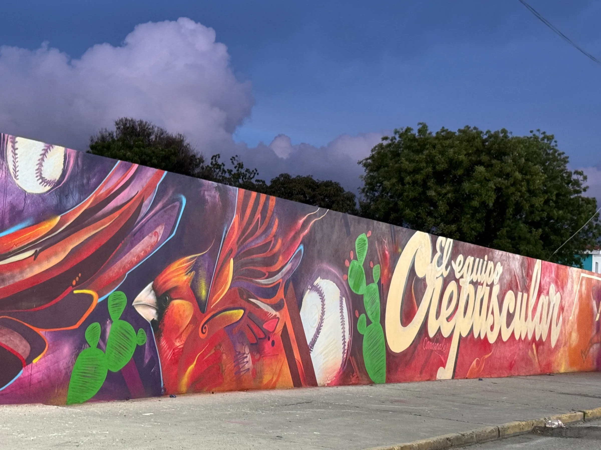
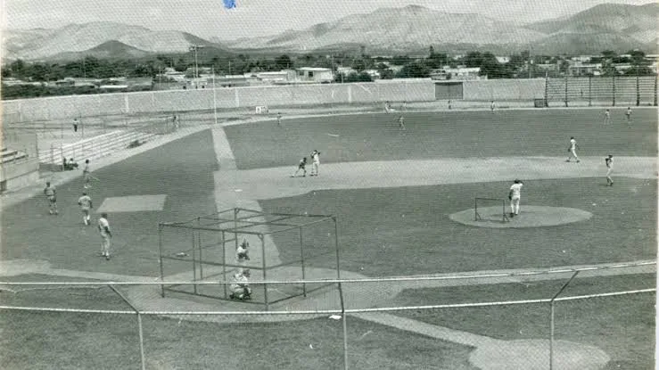
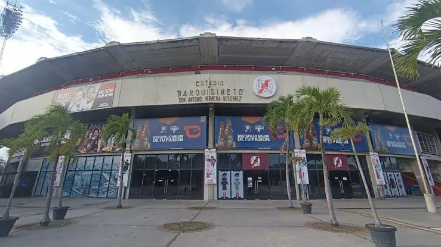
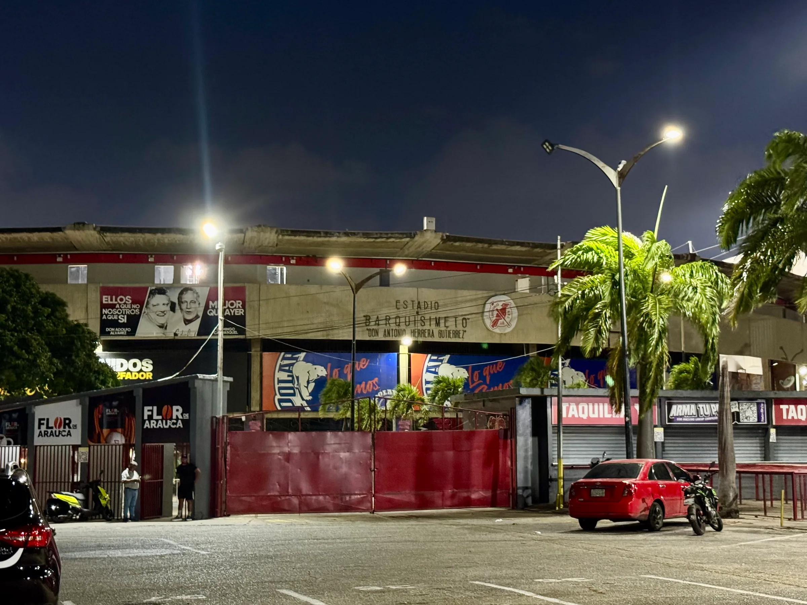
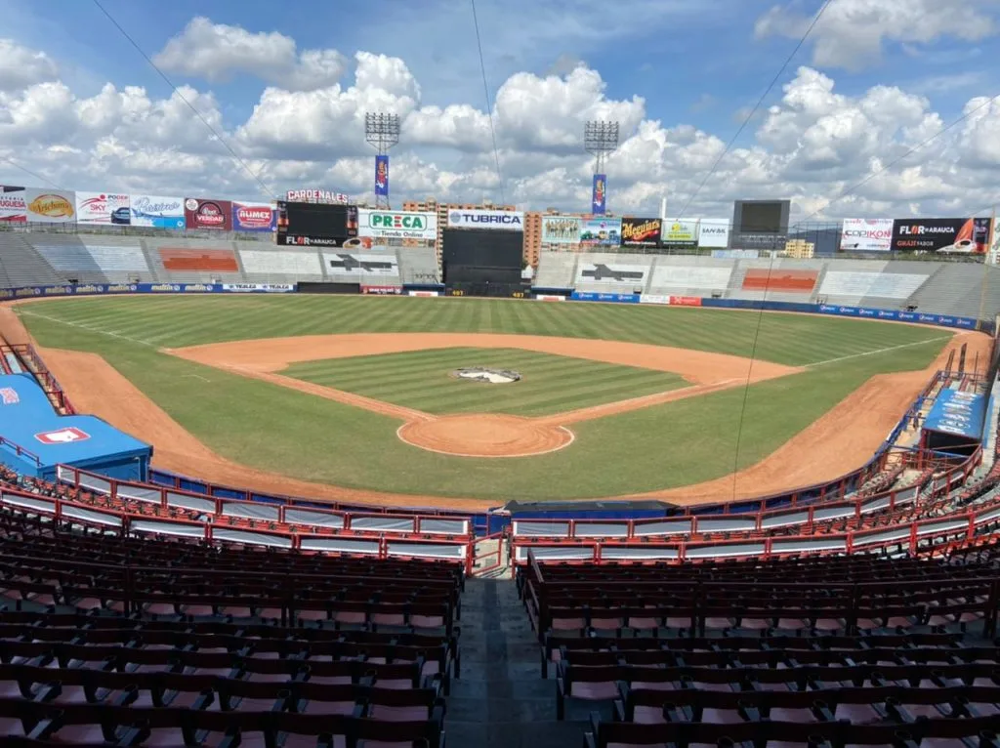
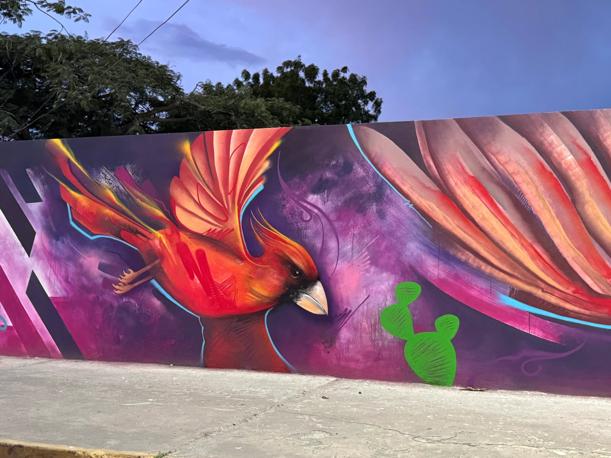
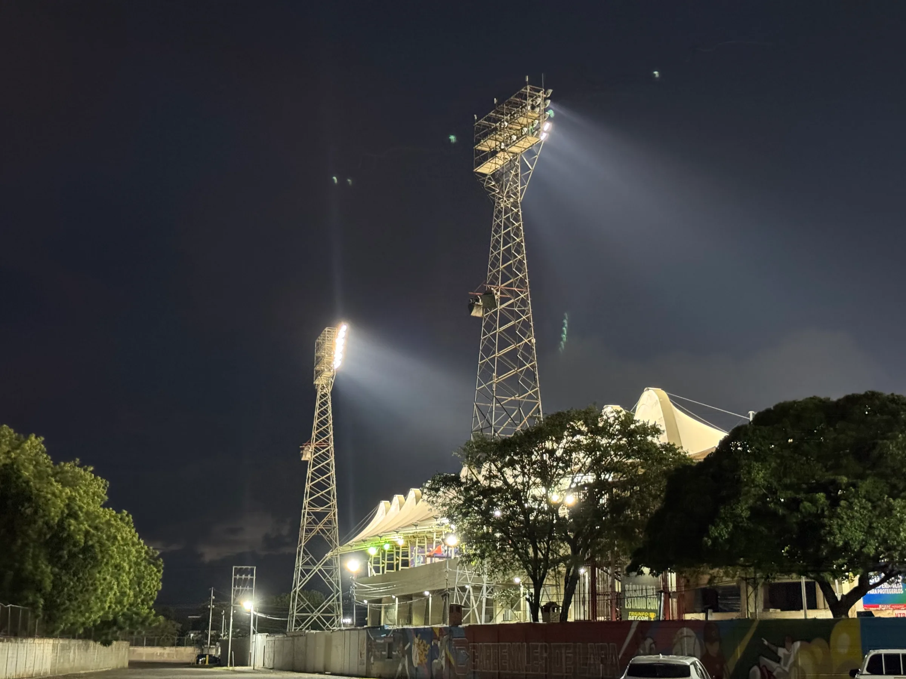
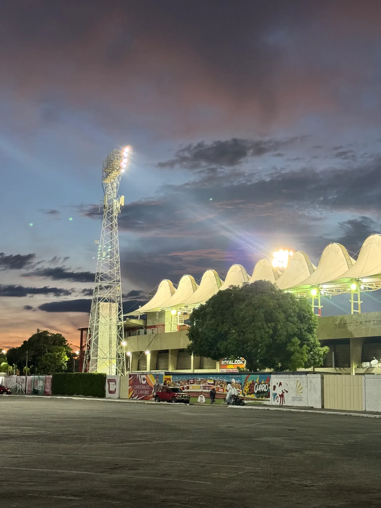
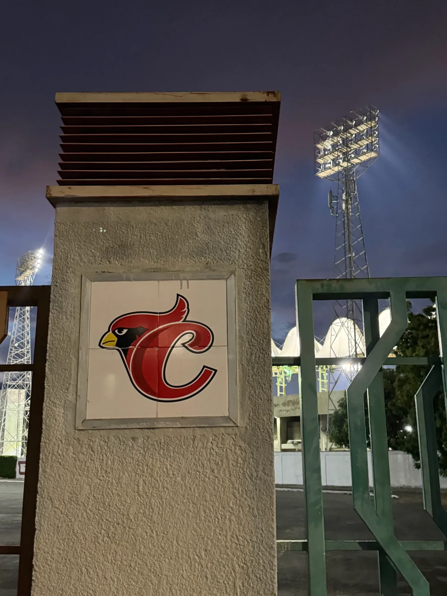

No es necesario ser fanático del béisbol para contagiarse de la energía de quienes visitan el estadio con pasión para ver a su equipo jugar. En sus gradas conviven familias, grupos de amigos y generaciones de larenses que encuentran en el deporte una forma de compartir emociones y sentirse parte de una comunidad.

<Figure credit="Foto: Mariángel León Ortiz.">

</Figure>

## Un estadio para la capital larense

Su origen se remonta a 1964, cuando el gobernador Miguel Romero Antoni presentó el proyecto de un estadio que sustituyera al antiguo Estadio Olímpico Lara, hoy conocido como Daniel «Chino» Canónico. La obra fue impulsada por el Ministerio de Obras Públicas y el Ejecutivo regional, y ejecutada por la Constructora CANPA, S. A., y el 26 de noviembre de 1968 abrió sus puertas bajo el nombre de «Estadio Barquisimeto».

Su inauguración estuvo acompañada por un acontecimiento digno de comentar: un helicóptero de la Fuerza Aérea trasladó una pelota desde el antiguo Estadio Olímpico hasta las nuevas instalaciones, donde fue entregada al gobernador Said Padua Coronel para realizar el lanzamiento inaugural. La jornada reunió a miles de espectadores que presenciaron el primer encuentro de Cardenales de Lara en su nuevo hogar, frente a los Llaneros de Acarigua.

Según reseña el diario _El Impulso_, las instalaciones todavía no estaban completamente terminadas, por lo que los narradores deportivos transmitieron el encuentro desde el terreno en unas mesas improvisadas. Esta escena es muy distinta de las transmisiones actuales, pero desde ese momento, se vislumbraba la pasión que acompañaría al estadio durante las décadas siguientes.

<Archive credit="Archivo, autor sin identificar.">

</Archive>

<Facts>
  <Fact label="Inauguración">26 de noviembre de 1968, como «Estadio Barquisimeto»</Fact>
  <Fact label="Construcción">Constructora CANPA, S. A., para el Ministerio de Obras Públicas</Fact>
  <Fact label="Nombre actual">Antonio Herrera Gutiérrez, desde 1991</Fact>
  <Fact label="Equipo">Cardenales de Lara, nacido en Carora en 1942</Fact>
  <Fact label="Títulos nacionales">Siete; el último, en 2025</Fact>
</Facts>

Aunque Cardenales de Lara nació en Carora en 1942, su llegada al nuevo estadio consolidó su presencia en la capital larense. En 1991, el recinto recibió el nombre de Antonio Herrera Gutiérrez, en homenaje al empresario que desde 1944 fue el principal financista del equipo y contribuyó a su desarrollo hasta su fallecimiento en un accidente aéreo en 1969.

## Campeones en casa

Este lugar también ha sido testigo de momentos muy importantes para la historia del béisbol venezolano como el primer campeonato de los Cardenales de Lara. Este se obtuvo el 29 de enero de 1991 cuando derrotaron a los Leones del Caracas con una carrera por cero. El periodista deportivo Julio César Urdaneta recuerda aquella victoria como una celebración de fervor pocas veces vista en la ciudad, mientras que la narración de Alfonso Saer quedó grabada en la memoria de los seguidores del equipo y forma parte importante de nuestra cultura.

La historia continuó escribiéndose entre sus gradas con los campeonatos de 1999 y 2020, hasta llegar al 26 de enero de 2025, cuando los pájaros rojos consiguieron su séptimo título nacional tras vencer nueve carreras por cero a los Bravos de Margarita. Esta fue una nueva oportunidad para que los larenses compartieran la emoción de ver a su equipo coronarse campeón en casa.

<Timeline
  title="Del primer lanzamiento al séptimo título"
  description="Las fechas de los Cardenales en su casa."
>
  <Moment date="1942">Cardenales de Lara nace en Carora.</Moment>
  <Moment date="1968" datetime="1968-11-26">
    Abre el Estadio Barquisimeto, el 26 de noviembre. Los Llaneros de Acarigua ganan el primer
    juego, 5 a 4.
  </Moment>
  <Moment date="1991" datetime="1991-01-29">
    Primer campeonato, el 29 de enero: 1 a 0 ante los Leones del Caracas. Desde la temporada
    siguiente, el estadio lleva el nombre de Antonio Herrera Gutiérrez.
  </Moment>
  <Moment date="2025" datetime="2025-01-26">
    Séptimo título, 9 a 0 ante los Bravos de Margarita, celebrado en casa.
  </Moment>
</Timeline>

<ThenNow title="La entrada principal" description="La fachada de día, en el archivo, y hoy de noche.">

<Archive credit="Archivo, autor sin identificar.">

</Archive>

<Now year="2026" credit="Foto: Mariángel León Ortiz.">

</Now>

</ThenNow>

## Una noche de béisbol

Más allá de los títulos y las estadísticas, la experiencia de visitar el estadio está llena de música, los cánticos de los fanáticos pidiendo un hit para animar a su equipo, los aplausos, los gritos y una energía difícil de describir para quien no ha vivido una visita en temporada de béisbol.

<Archive credit="Archivo, autor sin identificar.">

</Archive>

<PullQuote>Encontrarse con una parte de su identidad.</PullQuote>

<Carousel
  title="Alrededor del estadio"
  description="Fotografías de Mariángel León Ortiz al caer la noche."
  label="Galería de fotos de los alrededores del estadio"
>

</Carousel>

La experiencia de un barquisimetano en el estadio trasciende los resultados de un encuentro, pues lo que es aún más importante, es encontrarse con una parte de su identidad y vivir el espacio junto a personas que comparten la misma conexión. Todos los larenses recuerdan su primera visita al estadio, aquel juego en el que más disfrutaron y, sobre todo, quiénes lo acompañaron a vivir cada jonrón.

<Sources>

- [Javier González y Carlos Figueroa Ruiz, Banesco: Cardenales de Lara, de Carora a Barquisimeto, 80 años en la pelota (2021)](https://www.banesco.com/biblioteca-digital/cardenales-de-lara-de-carora-a-barquisimeto-80-anos-en-la-pelota/)
- [El Impulso: Estadio Don Antonio Herrera Gutiérrez, historia, pasión y béisbol (2024)](https://www.elimpulso.com/2024/10/19/video-especial-estadio-antonio-herrera-gutierrez-historia-pasion-y-beisbol-12oct/)
- [Cardenales de Lara: historia oficial del equipo](https://cardenalesdelara.com/historia-de-cardenales-de-lara/)
- [Líder en Deportes: Cardenales conquista su séptimo título (2025)](https://www.liderendeportes.com/baseball/campeones-cardenales-de-lara-se-aduena-de-su-septimo-titulo/)
- [Noticias Barquisimeto: El nido de Cardenales fue inaugurado el 26-11-1968 (2023)](https://www.noticiasbarquisimeto.com/el-nido-de-cardenales-fue-inaugurado-el-26-11-1968-el-antonio-herrera-gutierrez-sopla-55-velitas/)
- [La Gran Aldea: El béisbol en Venezuela, bienvenido Cardenales de Lara (2026)](https://lga.lagranaldea.com/2026/05/03/el-beisbol-en-venezuela-bienvenido-cardenales-de-lara-y-ii-parte/)
- [Wikipedia: Cardenales de Lara](https://es.wikipedia.org/wiki/Cardenales_de_Lara)

</Sources>
